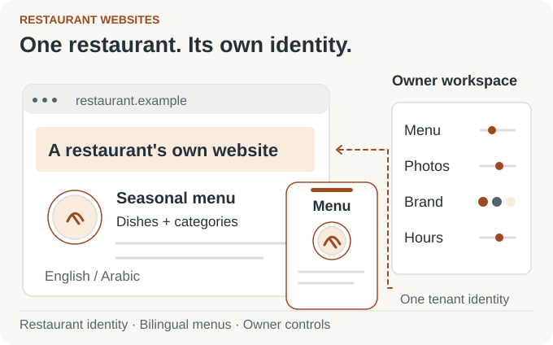
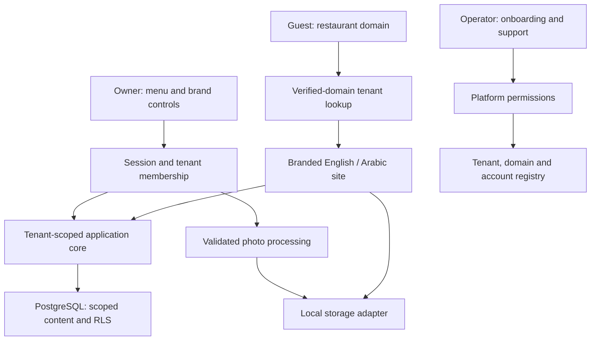

# Restaurant Websites

> [!CAUTION]
> **Portfolio scope.**
> This showcase explains the restaurant website application and its source-backed design. Illustrations are explanatory, and ordering is a separate design study. Hosted rollout, payment integration, automatic DNS verification, mobile applications, and test execution were not verified in this portfolio review.

## Branded restaurant sites. One shared engine.

I developed a restaurant website product around three connected experiences: a guest discovering a menu, an owner keeping it current, and an operator bringing another restaurant onto the service. Each restaurant gets its own identity and bilingual content, while the application shares its engineering underneath.

<picture>
  <source media="(prefers-color-scheme: dark) and (max-width: 520px)" srcset="assets/restaurant-story-v3-mobile-dark.svg">
  <source media="(max-width: 520px)" srcset="assets/restaurant-story-v3-mobile-light.svg">
  <source media="(prefers-color-scheme: dark)" srcset="assets/restaurant-story-v3-dark.svg">
  
</picture>

### From restaurant setup to a guest's next visit

The operator creates the restaurant and its owner's access. The owner shapes the site's theme, organizes menu sections, edits dishes and sizes, sets availability, uploads photos, and maintains opening hours. Guests see the restaurant's customer-facing site in English or Arabic.

The product's central idea is repeatable restaurant onboarding with owner control: shared infrastructure does the heavy lifting, while each business keeps its brand and content.

### My contribution

I developed the application and connected hostname-based tenant routing, owner and operator tools, reusable themes, bilingual interfaces, menu data, and media processing in one codebase. The architecture section below explains the boundaries visible in the current source.

<strong>Engineering details and design decisions</strong>

### How the current application fits together

| Area | Current source approach |
| --- | --- |
| Application | Next.js, React, and TypeScript. |
| Data | PostgreSQL and Drizzle; tenant-scoped repository access and row-level security for tenant content. |
| Identity | Verified-domain resolution for public sites; session and membership checks for owner actions. |
| Product surfaces | Separate guest sites, owner controls, and operator onboarding/support routes. |
| Branding | Theme configuration, palettes, logos, and reusable menu presentations. |
| Localization | English and Arabic routes, paired content fields, and right-to-left presentation. |
| Photos | Orientation correction, resizing, WebP encoding, and local storage behind an adapter. |

- [Application architecture and ordering design study](docs/portfolio-architecture.md)
- [Product journeys and interaction design](docs/portfolio-product-design.md)

### Delivered scope

The delivered application connects restaurant websites, bilingual menus, owner controls, and onboarding. The engineering notes also explore an ordering extension.

[Mahdi Hajj Hassan](https://github.com/MahdiHajjHassan)
