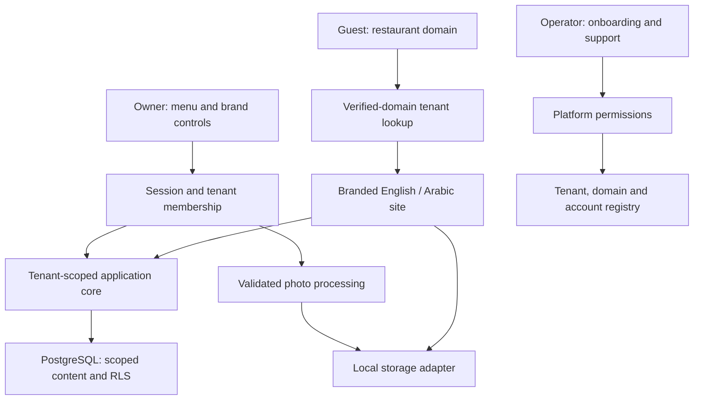

# Restaurant Websites

> [!CAUTION]
> **Public application and design study.** The website features described here are grounded in the public source. Diagrams explain the product. Ordering is a separate design study; deployment, payments, automatic DNS verification and test results are not established by this showcase.

## A branded bilingual website for each restaurant

I developed a shared website application for restaurant owners, guests and platform operators. Each restaurant has its own domain, menu and visual identity; owners manage their content, and guests browse dishes and restaurant information in English or Arabic.

**My contribution:** the application, domain-based restaurant routing, owner and operator tools, bilingual interfaces, themes, menu data and photo processing.

**Tools:** Next.js · React · TypeScript · PostgreSQL · Drizzle

<picture>
  <source media="(prefers-color-scheme: dark) and (max-width: 520px)" srcset="assets/restaurant-story-v4-mobile-dark.svg">
  <source media="(max-width: 520px)" srcset="assets/restaurant-story-v4-mobile-light.svg">
  <source media="(prefers-color-scheme: dark)" srcset="assets/restaurant-story-v4-dark.svg">
  
</picture>

### What each user can do

| User | Tasks |
| --- | --- |
| Guest | Browse dishes, sizes, prices, availability, opening hours and contact details. |
| Restaurant owner | Update menus, photos, language content and branding. |
| Platform operator | Set up restaurant accounts and domains, manage status and provide support access. |

### From setup to the guest's menu

1. The operator creates the restaurant and its owner account.
2. The owner maintains menu content, photos and the site's appearance.
3. The guest opens the restaurant's domain and browses its branded site in the chosen language.

### What I built

- **Restaurant identity and isolation:** domain-based routing connects guests to the right restaurant, with content and access scoped to that business.
- **Owner and operator workspaces:** menu and brand management are separate from platform onboarding and support permissions.
- **Reusable presentation:** themes, palettes and logos let restaurants share the application while keeping their own identity.
- **Bilingual content and media:** English/Arabic interfaces, right-to-left layouts and photo processing support the public menu experience.

<strong>Engineering details: restaurant isolation, domains, and owner tools</strong>

### Application and access flow

| Area | Implementation approach |
| --- | --- |
| Application | Next.js, React and TypeScript. |
| Database | PostgreSQL and Drizzle, with restaurant-scoped access and row-level security. |
| Public identity | Match a verified hostname to the restaurant. |
| Owner access | Check the session and restaurant membership before changes. |
| Platform operations | Separate onboarding and support permissions. |
| Branding and language | Reusable themes, palettes, logos, English/Arabic content and right-to-left layouts. |
| Photos | Correct orientation, resize, encode as WebP and store through an adapter. |

- [Application architecture](docs/portfolio-architecture.md)
- [Guest, owner, and operator journeys](docs/portfolio-product-design.md)

[Back to my portfolio](https://github.com/MahdiHajjHassan)
