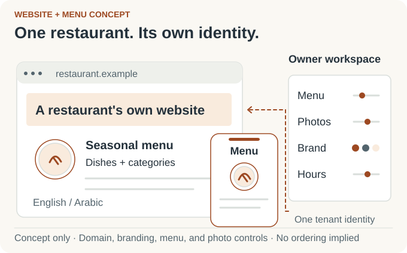
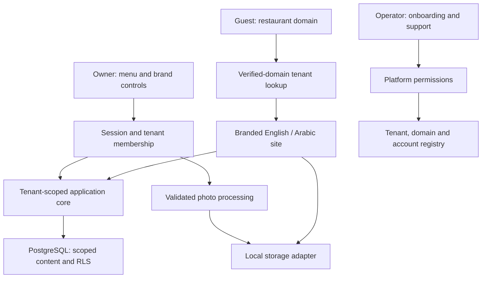

# Restaurant Websites

## Branded restaurant sites. One shared engine.

I developed a restaurant website product around three connected experiences: a guest discovering a menu, an owner keeping it current, and an operator bringing another restaurant onto the service. Each restaurant gets its own identity and bilingual content, while the application shares its engineering underneath.

*Personal product · Source-backed application showcase · No hosted rollout verified in this portfolio review*

<picture>
  <source media="(prefers-color-scheme: dark) and (max-width: 520px)" srcset="assets/restaurant-story-v2-mobile-dark.svg">
  <source media="(max-width: 520px)" srcset="assets/restaurant-story-v2-mobile-light.svg">
  <source media="(prefers-color-scheme: dark)" srcset="assets/restaurant-story-v2-dark.svg">
  
</picture>

*Concept illustration of the product roles; not an application screenshot.*

### From restaurant setup to a guest's next visit

The operator creates the restaurant and its owner's access. The owner shapes the site's theme, organizes menu sections, edits dishes and sizes, sets availability, uploads photos, and maintains opening hours. Guests see the restaurant's customer-facing site in English or Arabic.

The product's central idea is repeatable restaurant onboarding with owner control: shared infrastructure does the heavy lifting, while each business keeps its brand and content.

### My contribution

I developed the application and connected hostname-based tenant routing, owner and operator tools, reusable themes, bilingual interfaces, menu data, and media processing in one codebase. The architecture section below explains the boundaries visible in the current source.

<strong>Engineering details and design decisions</strong>

### How the current application fits together

*Architecture overview based on inspected source; not a screenshot or runtime-check result.*

| Area | Current source approach |
| --- | --- |
| Application | Next.js, React, and TypeScript. |
| Data | PostgreSQL and Drizzle; tenant-scoped repository access and row-level security for tenant content. |
| Identity | Verified-domain resolution for public sites; session and membership checks for owner actions. |
| Product surfaces | Separate guest sites, owner controls, and operator onboarding/support routes. |
| Branding | Theme configuration, palettes, logos, and reusable menu presentations. |
| Localization | English and Arabic routes, paired content fields, and right-to-left presentation. |
| Photos | Orientation correction, resizing, WebP encoding, and local storage behind an adapter. |

- [Application architecture and ordering design study](docs/portfolio-architecture.md)
- [Product journeys and interaction design](docs/portfolio-product-design.md)

### Delivered scope

This showcase covers restaurant websites, bilingual menus, owner controls, and onboarding. A separate ordering design study documents an extension; it is not evidence of implemented ordering, payment integration, automatic DNS verification, or a mobile application.

The repository includes tests and local performance records. This portfolio review inspected source but did not execute those checks or verify a customer deployment.

[Mahdi Hajj Hassan](https://github.com/MahdiHajjHassan)
