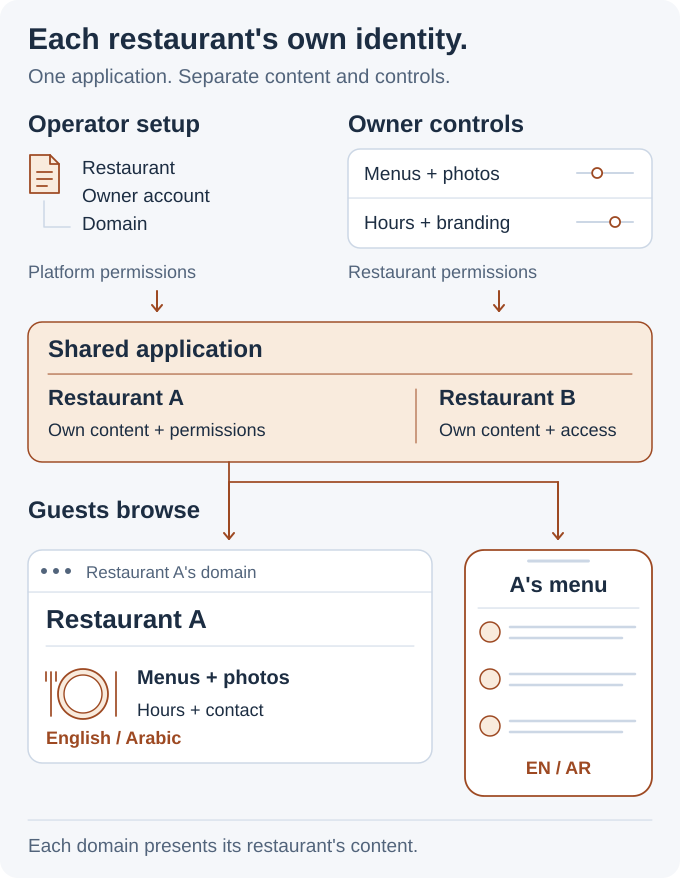
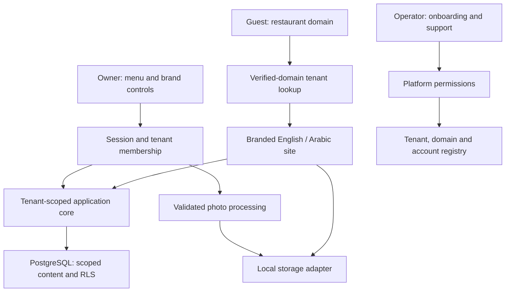

# Restaurant Websites

> [!CAUTION]
> **Public application and design study.** The website features described here are grounded in the public source. Diagrams explain the product. Ordering is a separate design study; deployment, payments, automatic DNS verification and test results are not established by this showcase.

## Each restaurant's own website, managed through one shared application

Restaurant owners need to keep their menu, photos, hours, and branding current. Guests need a clear menu on their phone. I developed a shared website product that gave each restaurant its own domain and identity, with English and Arabic content.

**My contribution:** the application, domain-based restaurant routing, owner and operator tools, bilingual interfaces, themes, menu data, and photo processing.

**Tools:** Next.js · React · TypeScript · PostgreSQL · Drizzle

<picture>
  <source media="(prefers-color-scheme: dark) and (max-width: 520px)" srcset="assets/restaurant-story-v4-mobile-dark.svg">
  <source media="(max-width: 520px)" srcset="assets/restaurant-story-v4-mobile-light.svg">
  <source media="(prefers-color-scheme: dark)" srcset="assets/restaurant-story-v4-dark.svg">
  
</picture>

### Three people, three clear jobs

| Person | What they do |
| --- | --- |
| Guest | Browse dishes, sizes, prices, availability, hours, and contact details. |
| Restaurant owner | Maintain menus, photos, language content, and branding. |
| Platform operator | Set up restaurant accounts, domains, status, and support access. |

The operator creates the restaurant and owner account. The owner edits the content and appearance. Guests see that restaurant's branded site in their chosen language.

### Why the shared application matters

New restaurants use the same application and onboarding process while retaining their own content and identity. Owner tools and platform tools have different permissions; restaurant data stays tied to its business.

<strong>Engineering details: restaurant isolation, domains, and owner tools</strong>

| Area | Approach |
| --- | --- |
| Application | Next.js, React, and TypeScript. |
| Database | PostgreSQL and Drizzle, with restaurant-scoped access and row-level security. |
| Public identity | Match a verified hostname to the restaurant. |
| Owner access | Check the session and restaurant membership before changes. |
| Platform operations | Separate onboarding and support permissions. |
| Branding and language | Reusable themes, palettes, logos, English/Arabic content, and right-to-left layouts. |
| Photos | Correct orientation, resize, encode as WebP, and store through an adapter. |

- [Application architecture](docs/portfolio-architecture.md)
- [Guest, owner, and operator journeys](docs/portfolio-product-design.md)

[Back to my portfolio](https://github.com/MahdiHajjHassan)
