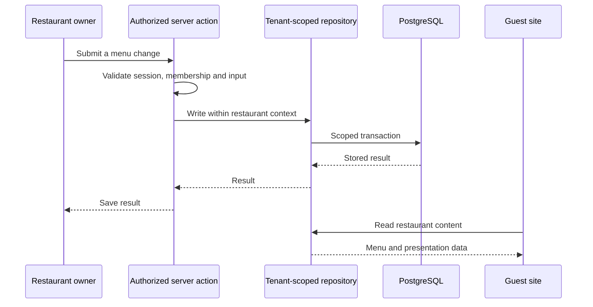
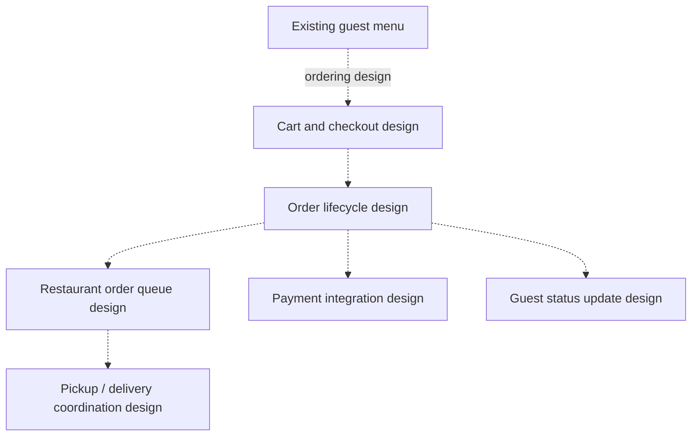

# Restaurant Websites | Application Architecture

> [!CAUTION]
> **Public application and design study.** The website features described here are grounded in the public source. Diagrams explain the product. Ordering is a separate design study; deployment, payments, automatic DNS verification and test results are not established by this showcase.

The application separates the restaurant a guest visits, the owner's access, platform operations, business data, and photo processing. A tenant is one restaurant account within the shared application.

## Application responsibilities

| Component | Responsibility | Why it matters |
| --- | --- | --- |
| Domain lookup | Match a verified hostname to a restaurant. | Guests reach the correct brand and menu. |
| Guest site | Render themes, bilingual menus, contacts, and hours. | Each restaurant has its own customer-facing content. |
| Owner access | Check the session and restaurant membership before writes. | Signing in does not grant access to another restaurant. |
| Operator tools | Set up accounts, manage domains/status, and enter support access. | Platform operations have separate permissions. |
| Application core | Organize menu, theme, contact, and identity logic. | Routes and UI use focused product modules. |
| Database | Use scoped transactions and PostgreSQL row-level security. | Business data is isolated in application access and database policies. |
| Media processing | Validate uploads, correct orientation, resize, and encode images. | Photo handling has defined inputs and storage behavior. |

Domain and membership records identify the restaurant before a scoped content transaction starts. Their access checks therefore occur before the restaurant's content policies apply.

## An owner changes the menu

## Ordering architecture study

The ordering design connects browsing to a cart, an order lifecycle, a restaurant queue, and guest updates.

The design specifies saved order prices, explicit order states, retry handling, and access rules for individual orders. These decisions connect the order to the restaurant's existing menu and account structure.

[Project overview](../README.md) · [Product journeys](portfolio-product-design.md)
