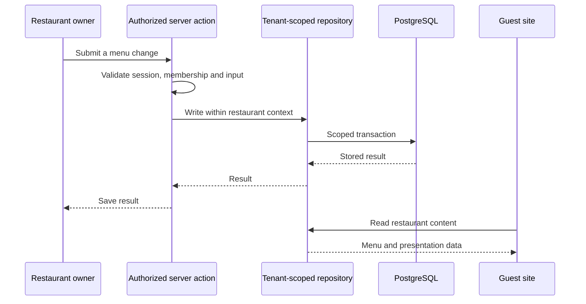
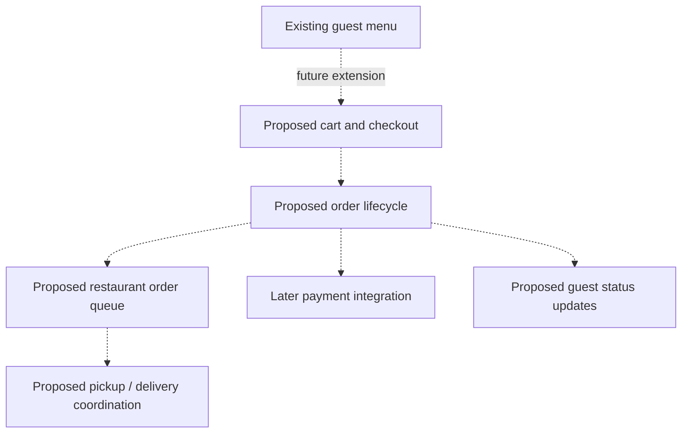

# Restaurant Websites: architecture and extension points

## Current implementation structure

This overview is grounded in the inspected application source. It explains component responsibilities; it does not certify deployed behavior.

| Boundary | Responsibility | Why it matters |
| --- | --- | --- |
| Public domain resolution | Match a verified hostname to a restaurant. | A visitor reaches the correct restaurant identity. |
| Guest presentation | Render theme, bilingual menu content, contacts, and opening hours. | Restaurant content remains distinct from operator tools. |
| Owner access | Authenticate the session and check restaurant membership for writes. | Being signed in alone is insufficient to administer another restaurant. |
| Operator access | Provision tenants, manage status/domains, and explicitly enter support access. | Platform operations have their own authority and UI. |
| Application core | Keep menu, theme, contact, identity, and data logic in focused modules. | Product logic has clear boundaries beneath the route/UI layer. |
| Data layer | Tenant-scoped transactions and PostgreSQL row-level security for tenant content. | Isolation is addressed in both application access and database policies. |
| Media | Validate and process uploads before storing encoded images. | Photo handling has a dedicated boundary rather than arbitrary file writes. |

Domain and membership records participate in resolving a tenant before a tenant-scoped transaction exists. Their authorization must therefore be explicit; the architecture does not claim that every table is protected by RLS.

## Owner update journey

*Current source-path overview; no update-speed or propagation guarantee is implied.*

## Future ordering concept

**Future product concept — not implemented in the inspected application.** These components are possible extensions of the existing product, rather than current features.

A future design would need snapshotted order prices, explicit order states, retry handling, and order-level access rules. None is inferred from the existing menu tables.

[Project overview](../README.md) · [Product design](portfolio-product-design.md)
